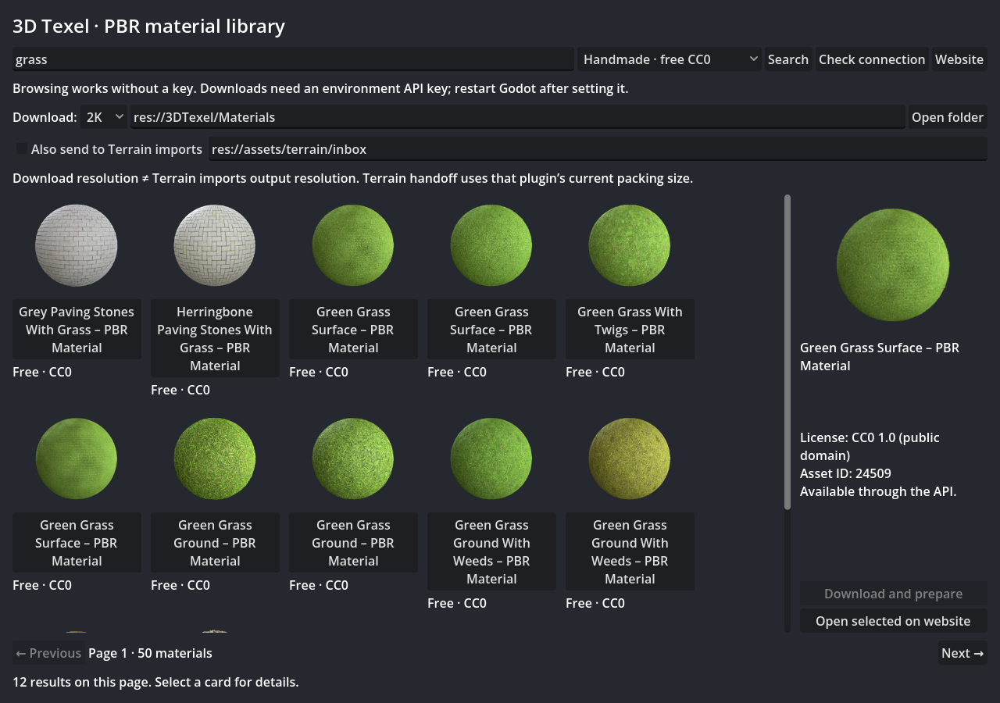

# 3D Texel Import for Godot

Browse 3DTexel PBR materials inside Godot, download free sets, and prepare native
GPU-compressed materials without manually packing maps.



Independent community addon for **Godot 4.4+**, tested on 4.7.2 with the Compatibility
renderer. No C#, Python runtime, Terrain3D or external image tools are required by
the addon. MIT licensed. [Inspiration and attribution](ATTRIBUTION.md).

## Install

Copy `addons/3dtexel/` into your project. Enable **3D Texel Import** under
**Project → Project Settings → Plugins**. Open the **3D Texel** main editor tab.

1. Search for a surface and select a preview card.
2. Choose 1K, 2K or 4K and an output directory.
3. Click **Download and prepare**.
4. Find `material.res` under the asset's actual-resolution folder and drag it onto a mesh.

The handmade library is free CC0. Community AI materials are browse-only in this
first release: the importer sends `max_credits: 0` and does not provide paid downloads
or generation. Source pages remain available through **Open selected on website**.
Some assets are website-only; API errors are shown without exposing credentials.

The browser fills the editor panel, adapts its grid column count to the available
width, wraps toolbar controls and stacks details beneath results in narrow windows.

## Authentication

Search works without a key. Downloads require a 3DTexel account and an API key with
download permission: https://3dtexel.com/api-keys/ . Set **TEXEL_API_KEY** in the
shell/environment that launches Godot. `3DTEXEL_API_KEY` and `TEXEL` are also recognized.
For fish, add `set -gx TEXEL_API_KEY ...` to your existing private secrets setup.
Do not put a real key in this repository, project settings or source files.

Restart Godot after changing its launch environment. A desktop launcher may not
inherit your terminal's environment. From a shell with your secrets loaded, use:

```sh
python3 tools/launch_editor.py /path/to/your/project
```

The optional launcher normalizes digit-leading `3DTEXEL_API_KEY` into conventional
`TEXEL_API_KEY` for shells that discard unusual names. It reads inherited environment
variables only; it does not read a secrets file. The addon never saves a key or sends it to a CDN. Use **Check connection** to verify.

## What gets prepared

- Original downloaded maps in `_source/`, ignored by Godot's resource importer.
- Mipmapped BC3/S3TC `*_texture.res` resources and a native `StandardMaterial3D` in `material.res`.
- OpenGL normal maps, automatically converted from DirectX when declared by the API.
- Anisotropic material filtering. Height is retained but displacement is off by default.
- Independent material AO; AO is not baked into the base color.
- `provenance.json`: asset ID/title/URL, returned license, requested and returned
  resolutions, actual packed dimensions, map hashes and import time.

The provider sometimes returns a resolution different from the requested one.
The UI reports it and folders use the returned label; provenance records actual
image dimensions as well. BC3 block storage can round non-aligned dimensions.
Existing completed imports are not overwritten. Incomplete downloads can be retried.
Signed download links and API responses containing account data are not saved.

## Optional Terrain3D handoff

If your project has the **Terrain Auto Import** companion used by scrappersDelight,
check **Also send to Terrain imports** and choose its watched inbox. The addon copies
original maps and publishes a `terrain_import.json` manifest only after the copy
finishes. It does not include or require Terrain3D and does not paint your terrain.

**Download resolution and terrain packing resolution are separate.** The companion
uses its current global output size; all texture layers in one Terrain3D library
must match. For a genuine 1K/2K/4K A/B, use separate target libraries/output roots and
matching companion output sizes. Downloading a 4K set while that packer is set to
1K still yields a 1K terrain layer. The standalone native material preserves source
resolution independently of terrain settings.

## Development and tests

```sh
godot --headless --path . -s tests/test_core.gd
```

Core tests are offline: saved compressed textures/mipmaps, DirectX conversion,
material settings, path safety, free-price gating, UI construction and terrain manifests.
The explicit live smoke uses your environment key and downloads asset 24509 (CC0)
with a zero-credit ceiling into the ignored `3DTexel/live_smoke/` directory:

```sh
godot --headless --path . -s tests/test_live.gd
```

Delete/move that ignored smoke folder to repeat the download test. For rendering the
browser screenshot with live public search: `godot --path . -s tests/preview.gd`.
The main development project enables the addon without altering a game's scenes.

API documentation: https://3dtexel.com/developers/ . Initial scope is PBR materials;
HDRIs, models, paid downloads, generation and user-library management are not implemented.
